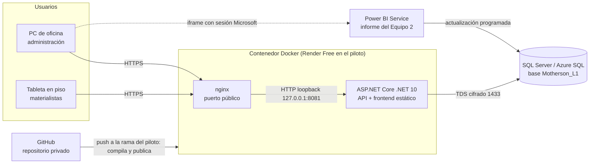
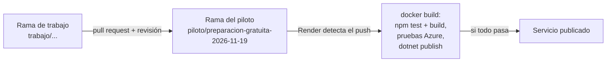

# Arquitectura y herramientas · Smart Material Replenishment (Motherson L1)

Documento de entrega para Motherson y el equipo de TI. Describe la versión vigente del piloto (administración v2 de cuatro líneas, 24/11/2026): sus componentes, cómo se comunican, qué herramientas usa y dónde vive cada dato. La instalación en infraestructura propia está en [GUIA_INSTALACION_LOCAL.md](GUIA_INSTALACION_LOCAL.md).

## 1. Vista general

- **Un solo servicio** sirve la interfaz (React compilado en `wwwroot`) y la API (`/api/...`) en el mismo origen HTTPS. No hay servidores separados de frontend y backend.
- **SQL es la única fuente de verdad.** El contenedor no guarda nada importante en disco: inventario, movimientos, atenciones, usuarios, imágenes y claves de sesión viven en SQL.
- **Power BI** lee SQL por su cuenta con actualizaciones programadas (lunes a viernes 06:00, 15:00 y 23:30). El portal solo muestra el informe en un iframe; abrirlo no actualiza datos.

## 2. Componentes

| Capa | Tecnología | Ubicación en el repositorio | Función |
| --- | --- | --- | --- |
| Interfaz | React 19.1, TypeScript 5.9, Vite 7.3 | `portal/frontend/` | Pantallas de administración, captura por bloques, KPIs, importación de Excel |
| Exportación/importación Excel | ExcelJS 4.4 (en el navegador) | `portal/frontend/src/importacionV2.ts`, `excelAdminV2.ts` | Lee `.xlsx`/`.csv`, genera plantillas y la descarga de KPIs |
| Informe embebido | powerbi-client 2.25 | `portal/frontend/src/DashboardEquipo2.tsx` | Muestra el informe con la sesión Microsoft de cada usuario |
| API y reglas de negocio | ASP.NET Core .NET 10 (C#) | `portal/backend/Motherson.Api/` | Autenticación, permisos, validación de capacidad, cajas completas, cobertura, KPIs |
| Acceso a datos | Dapper 2.1, Microsoft.Data.SqlClient 6.1 | mismo proyecto | Consultas y procedimientos almacenados |
| Base de datos | SQL Server 2022 / Azure SQL | `portal/db/azure/`, `portal/db/administracion/` | Esquemas `dbo` (modelo de 8 tablas), `mes` (operación del piloto) y `mes2` (administración de 4 líneas) |
| Proxy | nginx | `despliegue/render/iniciar.sh` | Recibe el tráfico público y lo pasa a Kestrel solo por loopback |
| Contenedor | Docker (imágenes oficiales node 22, dotnet sdk/aspnet 10) | `despliegue/render/Dockerfile` | Compila, corre pruebas y publica en una sola imagen |
| Hosting del piloto | Render Web Service Free (Ohio) | `render.yaml`, `despliegue/render/` | Despliegue automático desde la rama del piloto |
| Reportes | Power BI (`Motherson.pbix`, modelo TMDL) | `powerbi/` | Dashboard del Equipo 2 |
| Pruebas | Vitest, programas .NET de integración, Playwright | `portal/frontend/src/*.test.ts`, `portal/pruebas-*` | Ver sección 7 |

## 3. Modelo de datos

**Esquema `dbo` (8 tablas acordadas con el Equipo 2):** ESTACION, ESTANTERIA, UBICACION, MATERIAL, COLOR, PUESTO_LOGISTICO, REGISTRO y TURNO. Contiene el histórico y la Línea 1 anterior a la ampliación. Después de activar la v2, unos disparadores impiden que versiones viejas del portal escriban saldos ahí.

**Esquema `mes2` (administración de cuatro líneas):**

| Tabla | Contenido |
| --- | --- |
| `LINEA` | Líneas 1 a 4, con versión y fecha de apertura |
| `ACCESO` | Qué cuenta ve qué línea y con qué puesto |
| `ENTIDAD` | Materiales, puestos, estaciones, estanterías, ubicaciones, atenciones y calendario de cada línea, guardados como JSON |
| `EVENTO` | Bitácora inmutable de cada operación: quién, cuándo, solicitud, cambios antes/después y comprobante (UUID) |
| `IMAGEN` | Fotografías PNG/JPG de materiales (hasta 5 MB) |
| `CONFIG` | Activación y modo de solo lectura |

Para Power BI, `002_fuentes_powerbi.sql` publica **vistas con la forma de las 8 tablas** (`mes2.bi_MATERIAL`, `mes2.bi_UBICACION`, `mes2.bi_REGISTRO`, …). El informe no lee el JSON directamente.

**Cuentas personales (`mes.USUARIO_PILOTO`):** roles ADMIN, PUESTO (materialista) y LECTOR. Las contraseñas se guardan como hash de ASP.NET Identity. No existe registro público: las cuentas se crean por consola administrativa.

## 4. Cómo se procesa una operación

Toda escritura de la administración v2 (entrada, salida, atención, importación, desactivar ubicación, nueva revisión, etc.) sigue el mismo camino:

1. La pantalla envía `POST /api/v2/lineas/{línea}/operaciones/{TIPO}` con la **versión** de la línea que estaba viendo, un **UUID de operación** y el token CSRF.
2. La API vuelve a cargar el estado de la línea, revisa el rol y aplica las reglas: capacidad en cajas (una caja abierta ocupa una completa), salidas solo para administración, material o ubicación desactivados, etc.
3. El procedimiento `mes2.Guardar` toma un candado exclusivo de la línea, comprueba que la versión no haya cambiado, guarda los cambios y el evento **en una sola transacción** e incrementa la versión.
4. Si la respuesta se pierde (red de planta), la pantalla guarda la operación pendiente y la reintenta con el **mismo UUID**. El servidor devuelve el comprobante original en lugar de duplicarla.

Si dos personas capturan al mismo tiempo, una se confirma y la otra recibe "Los datos cambiaron. Actualiza y revisa"; nunca hay saldos perdidos en silencio.

## 5. Seguridad

- HTTPS de extremo a extremo. Las cookies son `Secure`, `HttpOnly` y `SameSite=Strict`, y la sesión dura 30 minutos.
- Todo `POST` exige token CSRF. Los permisos se vuelven a validar en cada petición y en SQL.
- La cuenta SQL de la aplicación (`portal_app`) no puede modificar tablas directamente; solo ejecuta los procedimientos autorizados.
- Las claves de protección de sesión se guardan en SQL cifradas con un certificado privado (`Pilot__KeyEncryptionCertificate`).
- Ningún secreto vive en el repositorio. Las configuraciones privadas se guardan en `portal/.local/` (excluida de Git y de la imagen Docker) y en las variables privadas del hosting.

## 6. Entrega continua

- Se trabaja en ramas propias y se integra por pull request, porque **todo lo que llega a la rama del piloto se publica solo**.
- Las migraciones SQL **nunca** se ejecutan al publicar: son un paso administrativo aparte (`--administracion-instalar` y `--administracion-activar`). Ver `documentacion/administracion-v2/ACTUALIZACION_Y_RECUPERACION.md`.
- Para revertir, Render permite volver a un despliegue anterior. Revertir código no revierte datos.

## 7. Pruebas

| Conjunto | Comando | Requiere |
| --- | --- | --- |
| Frontend (70 pruebas) | `cd portal/frontend && npm ci && npm test` | Node 22 |
| Compilación completa como en producción | `docker build -f despliegue/render/Dockerfile -t motherson-prueba .` | Docker |
| Integración SQL de administración v2 | `python3 portal/scripts/probar_administracion_local.py` | SQL Server 2022 local en Docker, .NET 10, Python 3.11 |
| HTTP con sesión y CSRF | `python3 portal/scripts/probar_http_administracion.py` | Servicio local de la fila anterior con `--servir` |
| Motor de cobertura | `portal/pruebas-cobertura` | .NET 10 |

## 8. Herramientas necesarias

| Para… | Herramienta | Versión |
| --- | --- | --- |
| Ejecutar el sistema | Docker (Desktop o Engine) | Reciente, con soporte para `linux/amd64` |
| Base de datos | SQL Server 2022 (Developer, Standard o Enterprise) o Azure SQL | 2022 / compatibilidad 160 |
| Compilar sin Docker | .NET SDK | 10.0 |
| | Node.js y npm | 22 |
| Scripts administrativos | Python | 3.11 o posterior |
| Reportes | Power BI Desktop / Service | Licencia individual o capacidad compatible por visitante |
| Código | Git y una cuenta de GitHub con acceso al repositorio privado | — |
| Editar | VS Code, Visual Studio 2022+ o Rider | — |

## 9. Límites conocidos del piloto

- Render Free (512 MB, 0.1 CPU) se duerme tras 15 minutos sin uso y tarda cerca de un minuto en despertar. No es un servicio de producción.
- La base Azure gratuita puede pausarse por inactividad o por agotar su cuota mensual.
- No se ha certificado la capacidad para 80 usuarios simultáneos; se recomienda crecer por etapas (5–10, luego 20).
- Power BI no es tiempo real: depende de su actualización programada y de las licencias de cada visitante.
- El calendario de turnos configurado es de referencia (simulado); planta debe validar los turnos y descansos reales.
